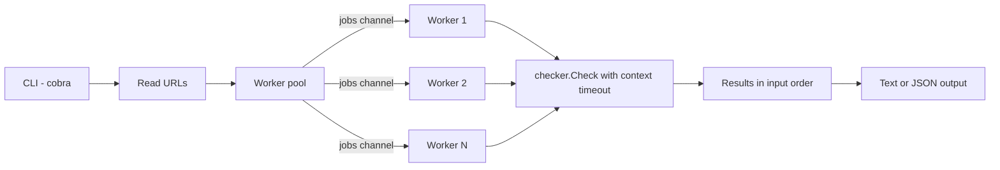

# GlowPulse

[](https://github.com/YoumnaSalloum/glowpulse/actions/workflows/ci.yml)

A fast, concurrent website health checker written in Go. GlowPulse checks many sites at the same time and reports uptime, response time, TLS certificate expiry and missing security headers.


## Features

- Checks many websites concurrently with a worker pool (goroutines, channels, `sync.WaitGroup`)
- Per-site timeout and clean cancellation with Ctrl+C or SIGTERM (`context`)
- Health status: `UP` (2xx/3xx), `DEGRADED` (4xx) or `DOWN` (5xx, timeouts, TLS errors)
- Days until the TLS certificate expires
- Missing security headers: HSTS, CSP, X-Content-Type-Options, X-Frame-Options, Referrer-Policy
- Readable output with a summary line, or `--json` for scripts
- Reads URLs from a file

## Install

```bash
go install github.com/YoumnaSalloum/glowpulse/cmd/glowpulse@latest
```

Requires Go 1.27 or newer.

## Usage

```bash
glowpulse check https://google.com
glowpulse check -w 20 -t 3s https://google.com https://github.com
glowpulse check -f examples/urls.txt --json
```

| Flag | Short | Default | Description |
|---|---|---|---|
| `--workers` | `-w` | `10` | How many sites to check at the same time |
| `--timeout` | `-t` | `10s` | Maximum time to wait for each site |
| `--file` | `-f` | | Read URLs from a file, one per line (`#` starts a comment) |
| `--json` | | `false` | Print the results as JSON |

The exit code is `0` when every site is `UP` and `1` otherwise, so GlowPulse works in scripts and CI.

## How it works



- `cmd/glowpulse` holds the CLI: commands, flags, input and output.
- `internal/pool` hands URLs to a fixed number of goroutines over a channel, waits with a `WaitGroup`, and stops giving out work when the context is cancelled.
- `internal/checker` checks one URL: HTTP request with a context timeout, status, TLS expiry and security headers. It shares one `http.Client` so connections are reused.

## Performance

Checking the 11 sites in `examples/urls.txt` with a 3-second timeout on a MacBook Pro M1:

| Workers | Total time |
|---|---|
| 1 | 8.142s |
| 11 | 3.001s |

```bash
glowpulse check -f examples/urls.txt -t 3s -w 1
glowpulse check -f examples/urls.txt -t 3s -w 11
```

Checks are I/O-bound, so with more workers the waiting overlaps and the total time drops from the sum of all requests to roughly the slowest one.

## Development

```bash
go test -race ./...
go vet ./...
gofmt -l .
```

CI runs all three on every push and pull request. Tests use `httptest` to run against a local fake server, so they don't need the internet.

## Roadmap

- [x] CLI with concurrent checks, timeouts and cancellation
- [ ] Retries with backoff and per-host rate limiting
- [ ] REST and gRPC API with PostgreSQL
- [ ] Kafka-based scheduler and workers
- [ ] Next.js dashboard with live updates over WebSockets
- [ ] Kubernetes deployment with Helm, Terraform, Prometheus and Grafana

## License

[MIT](LICENSE)
